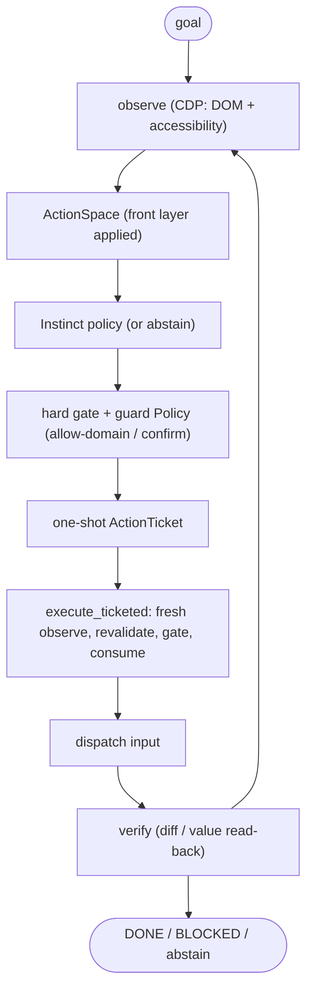
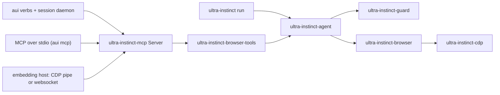

<p align="center">
  <a href="https://hdqwalls.com/wallpaper/3440x1440/goku-jiren-masterd-ultra-instinct">
    
  </a>
</p>

# ultra-instinct

**Ultra-Instinct is a Rust-native browser-agent runtime.** The agent owns the
loop: it observes the page, builds a finite action space, lets a deterministic
policy (Instinct) choose or abstain, and runs the choice only through a one-shot
`ActionTicket` that a hard guard issued and the executor revalidates on a fresh
look. Then it verifies the effect. No LLM and no MCP are needed to run it.
When an agent or a person reads the page instead, the shell verbs, the MCP
tools and an embeddable server run each step they pick through the same guard.





Rust 1.99.0. Crates are `ultra-instinct-*` 0.1.0 on crates.io; the API is
unstable until 1.0. The binary is `ultra-instinct`, with `aui` as a short
alias. Every crate is `#![forbid(unsafe_code)]`.

## Install

```bash
scripts/install-aui.sh   # idempotent; installs aui + ultra-instinct to ~/.cargo/bin
aui doctor               # checks Chrome, the --cdp endpoint, a test launch, $TMPDIR/aui
aui install              # prints the Chrome for Testing install command (--run runs it)
```

`ULTRA_INSTINCT_CHROME=<path>` picks the Chrome binary. Agents: read
[`skills/ultra-instinct/SKILL.md`](skills/ultra-instinct/SKILL.md), or
`aui skills get core` for the full guide that ships in the binary. A Claude
Code subagent that drives a private headless Chrome through `aui mcp` is in
[`agents/screen-driver.md`](agents/screen-driver.md).

## Two ways to drive

The guard, tickets and policy are the same in both. What differs is who
picks the next action.

| Who reads the page | Use | Who picks each step |
|---|---|---|
| An agent or a person (Claude, you) | the shell verbs or the MCP `browser_*` tools | the caller, one call per step |
| Nobody: a script, a cron job, a bot host | `aui run --goal`, `run_goal` | the runtime: Instinct (no LLM, no tokens, same input same result), or an optional remote policy that may only pick an offered action |

Instinct handles plain forms ("type X in Search, then click Go") and
abstains rather than guess on harder pages. An agent can try `--goal` once
on a simple form and switch to the verbs when it abstains.

Step by step from a shell, through a session daemon:

```bash
aui open --launch https://shop.example/join   # daemon + its own Chrome
aui snap                                      # @e1 textbox "Email"  value="" …
aui type @e2 "kid@example.com"
aui click @e5                                 # ✓ ticket 41 · navigation
aui wait --text "Welcome" --timeout 10
aui close                                     # stops the daemon and its Chrome
```

MCP: run `aui mcp` as a stdio server (56 tools: `observe`, `guard`, `verify`
and the `browser_*` tools). Index presses take the `@eN` refs
`browser_get_state` returns.

One goal, one command. `--decision` picks who chooses each step:
`instinct` (no model), `model` (your `TEXT_MODEL_*` endpoint), `jev`, or
`clef` / `clef-flash`; an `aui` built with the `jev` feature (as
`install-aui.sh` builds it) defaults to `jev`. `--launch` starts a headless
Chrome for the run and kills it at exit; `--cdp <url>` attaches to yours
instead.

```bash
aui run --launch --decision instinct --url https://example.com --goal 'Type "rust" into Search'

# Any OpenAI-compatible, Anthropic, or Gemini endpoint chooses every step
TEXT_MODEL_API=openai TEXT_MODEL_BASE_URL=https://api-gateway.merge.dev/v1 \
TEXT_MODEL_API_KEY=... TEXT_MODEL=openai/gpt-5-nano \
  aui run --launch --decision model --url https://example.com --goal 'Type "rust" into Search'
```

The model only picks from the actions the runtime offers (or abstains),
with the screenshot and page text as evidence; every pick still goes
through the gate and a one-shot ticket.

As a library, the same loop:

```rust,ignore
use ultra_instinct_agent::AgentBuilder;
use ultra_instinct_browser::{launch, open_tab, BrowserSession};
use ultra_instinct_policy::InstinctPolicy;

let chrome = launch::launch(&launch::LaunchOptions::default())?; // killed on drop
let mut session = BrowserSession::new(open_tab(&chrome.endpoint())?);
session.navigate("https://example.com")?;
let mut agent = AgentBuilder::new(session, InstinctPolicy::default())
    .max_steps(20)
    .build(r#"Type "rust" into Search"#);
let outcome = agent.run(); // Done | Blocked | Abstained | Failed
```

Every tool and verb: [`docs/tools.md`](docs/tools.md). Run flags:
`aui --help`.

## Safety

- **Hard gate and tickets.** Disabled, readonly, hidden, occluded,
  offscreen or behind-a-modal targets never run. A press runs only through
  a one-shot ticket, revalidated on a fresh observation; a changed page
  refuses instead of pressing the wrong element.
- **Domain allow-list.** `--allow-domain shop.example` (or `*.shop.example`)
  allows input only on those hosts, checks navigation URLs first, and
  refuses a press that would submit a form to another host. `data:`,
  `javascript:`, `file:` and other non-web pages refuse too.
- **Confirm before press.** `--confirm-press "Pay*"` blocks a matching press
  until the user's `--confirm "<label>"` (or a tool call's `confirm`, that
  call only). Enter / Space on a button and Enter in a form that submits
  through a matching button count as presses.
- **Snapshot-bound presses.** An MCP press given the `snapshot` id it was
  chosen from refuses `stale_ref` if that element moved, changed or left.
  Every `aui` verb press is bound to the latest `aui snap` the same way.
- **Secrets fail closed.** Password, hidden, file and secret-labelled fields
  never show a value; text typed into one is masked in every later output,
  error and HAR file; screenshots hide those fields or refuse.
- **Files and tools.** File paths must be absolute; a host can keep
  downloads and uploads to one folder and serve only an allow-list of tools.
- **Closed model replies.** An optional remote policy may only pick an
  offered choice or abstain.

Report vulnerabilities as described in [`SECURITY.md`](SECURITY.md).

## Embedding

A host that launches Chromium with `--remote-debugging-pipe` hands the pipe
ends to a `PipeBrowser`, builds `ultra_instinct_mcp::Server::with_pipe`, and
calls `Server::call_tool` with the same tools; `Server::run_goal` runs the
agent loop on its tab. The example, host options, limits, threading and the
62 error codes are in [`docs/embedding.md`](docs/embedding.md).

## Crates

| Crate | Role |
|---|---|
| `ultra-instinct-core` | `InteractionManifold`, regions, `ActionSpace`, fixture grammar |
| `ultra-instinct-geometry` | Viewport geometry helpers and `RegionState` |
| `ultra-instinct-observe` | Observation history, snapshot ring, id diff |
| `ultra-instinct-cdp` | CDP transports: websocket, replay, caller-owned pipe; tab backends |
| `ultra-instinct-chrome` | Find and launch a local Chrome |
| `ultra-instinct-browser` | CDP observe (DOM/AX fusion, label folding, identity, stacking), inputs, saved state |
| `ultra-instinct-protocol` | Guard / ticket / verify wire types |
| `ultra-instinct-guard` | Hard gate, `ActionTicket`, ledger, world snapshots, the user `Policy` |
| `ultra-instinct-policy` | `InstinctPolicy`, `TextResolver`, optional model-text and remote policies |
| `ultra-instinct-agent` | The `Agent` loop, `execute_ticketed`, verification, `MockBrowser` |
| `ultra-instinct-browser-tools` | The `browser_*` tools over a `BrowserHost` trait, error codes, secret masking |
| `ultra-instinct-mcp` | JSON-RPC adapter and the embeddable `Server` |
| `ultra-instinct-remote` | Remote decision transports and the HTTP text model (the only model / HTTP client crate) |
| `ultra-instinct` | The `ultra-instinct` / `aui` CLI and session daemon |
| `ultra-instinct-dojo` | Battle diary, replay arena, lesson store |

## Development

```bash
cargo test --workspace
scripts/check_repo_rules.sh && python3 scripts/check_architecture.py
```

Live Chrome tests are `#[ignore]`; CI uses CDP replay fixtures. The bench
harness in `bench/` compares browser tools and agents on local scenario
sites. Read [`AGENTS.md`](AGENTS.md) (the anti-drift rules and test owners)
before changing the agent path.

## License

MIT, see [`LICENSE`](LICENSE).
