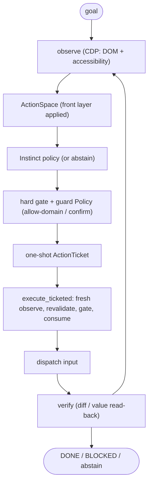
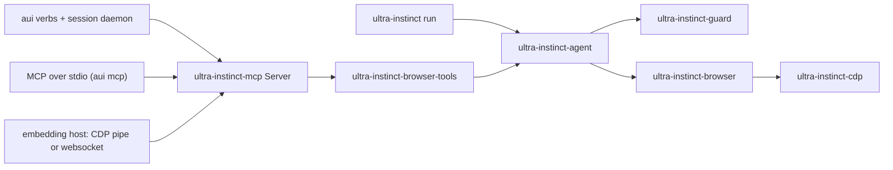

# Architecture

How ultra-instinct is put together. For use, start at the [README](../README.md);
for the rules that keep this shape, see [AGENTS.md](../AGENTS.md).

The agent owns the loop: it observes the page, builds a finite action space,
lets a deterministic policy (Instinct) choose or abstain, and runs the choice
only through a one-shot `ActionTicket` that a hard guard issued and the
executor revalidates on a fresh look. Then it verifies the effect. No LLM and
no MCP are needed to run it. When an agent or a person reads the page
instead, the shell verbs, the MCP tools and an embeddable server run each
step they pick through the same guard.





## Two ways to drive

The guard, tickets and policy are the same in both. What differs is who
picks the next action.

| Who reads the page | Use | Who picks each step |
|---|---|---|
| An agent or a person (Claude, you) | the shell verbs or the MCP `browser_*` tools | the caller, one call per step |
| Nobody: a script, a cron job, a bot host | `aui run --goal`, `run_goal` | the runtime: Instinct (no LLM, no tokens, same input same result), or an optional remote policy that may only pick an offered action |

Instinct handles plain forms ("type X in Search, then click Go") and
abstains rather than guess on harder pages. An agent can try `--goal` once
on a simple form and switch to the verbs when it abstains.

## Who decides in `aui run`

One goal, one command. `--decision` picks who chooses each step:
`instinct` (no model), `model` (your `TEXT_MODEL_*` endpoint), `jev`, or
`clef` / `clef-flash`; with no flag it is `jev` when
`TYPESAFE_API_KEY` is set and `instinct` otherwise, so a first run needs no
key. `--launch` starts a headless
Chrome for the run and kills it at exit; `--cdp <url>` attaches to yours
instead.

```bash
aui run --launch --decision instinct --url https://example.com --goal 'Type "rust" into Search'

# Any OpenAI-compatible, Anthropic, or Gemini endpoint chooses every step
TEXT_MODEL_API=openai TEXT_MODEL_BASE_URL=https://api-gateway.merge.dev/v1 \
TEXT_MODEL_API_KEY=... TEXT_MODEL=openai/gpt-5-nano \
  aui run --launch --decision model --url https://example.com --goal 'Type "rust" into Search'
```

The model only picks from the actions the runtime offers (or abstains),
with the screenshot and page text as evidence; every pick still goes
through the gate and a one-shot ticket.

## As a library

The same loop:

```rust,ignore
use ultra_instinct_agent::AgentBuilder;
use ultra_instinct_browser::{launch, open_tab, BrowserSession};
use ultra_instinct_policy::InstinctPolicy;

let chrome = launch::launch(&launch::LaunchOptions::default())?; // killed on drop
let mut session = BrowserSession::new(open_tab(&chrome.endpoint())?);
session.navigate("https://example.com")?;
let mut agent = AgentBuilder::new(session, InstinctPolicy::default())
    .max_steps(20)
    .build(r#"Type "rust" into Search"#);
let outcome = agent.run(); // Done | Blocked | Abstained | Failed
```

## Embedding

A host that launches Chromium with `--remote-debugging-pipe` hands the pipe
ends to a `PipeBrowser`, builds `ultra_instinct_mcp::Server::with_pipe`, and
calls `Server::call_tool` with the same tools; `Server::run_goal` runs the
agent loop on its tab. The example, host options, limits, threading and the
63 error codes are in [`docs/embedding.md`](embedding.md).

## Crates

| Crate | Role |
|---|---|
| `ultra-instinct-core` | `InteractionManifold`, regions, `ActionSpace`, fixture grammar; modules `geometry` (viewport geometry helpers, `RegionState`), `observe` (observation history, id diff) and `protocol` (guard / ticket / verify wire types) |
| `ultra-instinct-cdp` | CDP transports: websocket, replay, caller-owned pipe; tab backends |
| `ultra-instinct-chrome` | Find and launch a local Chrome |
| `ultra-instinct-browser` | CDP observe (DOM/AX fusion, label folding, identity, stacking), inputs, saved state |
| `ultra-instinct-guard` | Hard gate, `ActionTicket`, ledger, world snapshots, the user `Policy` |
| `ultra-instinct-policy` | `InstinctPolicy`, `TextResolver`, optional model-text and remote policies |
| `ultra-instinct-agent` | The `Agent` loop, `execute_ticketed`, verification, `MockBrowser` |
| `ultra-instinct-browser-tools` | The `browser_*` tools over a `BrowserHost` trait, error codes, secret masking |
| `ultra-instinct-mcp` | JSON-RPC adapter and the embeddable `Server` |
| `ultra-instinct-remote` | Remote decision transports and the HTTP text model (the only model / HTTP client crate) |
| `ultra-instinct` | The `ultra-instinct` / `aui` CLI and session daemon |
| `ultra-instinct-dojo` | Battle diary, replay arena, lesson store |
